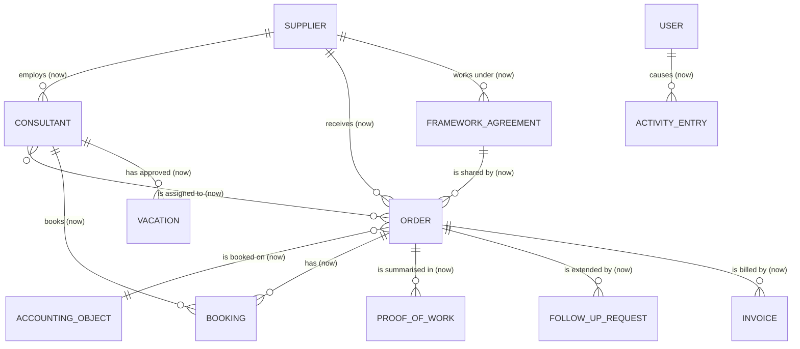

# Domain model

> Filled in on Friday, 30 Oct 2026 (task #18). See [guide 2.3](https://github.com/DanielStuewe/article26-hackathon-2026/blob/main/docs/guide.md#23-model-the-domain).

## Glossary

| Term | Meaning |
|---|---|
| Purchase order (Auftrag) | The client's commission to a supplier for a piece of work: an order number, a budget in person-days and a period. |
| Person-day (PT) | Unit of budget and effort: 8 booked hours equal 1 PT. |
| Accounting object | Client-side cost object (cost centre or project element) that hours are booked against. |
| Consultant | An external person employed by a supplier who books working time on orders. |
| Supplier | The company that delivers consultants and records their working time (e.g. Consultis GmbH). |
| Activity entry | One thing that happened: someone signed in, changed their profile, saved a booking or approved a proof of work. Who may read it depends on the role. |
| Booking | One entry of working time: date, start and end time, duration, description, consultant, order and accounting object. Created by a consultant, checked server-side against the business rules before it is stored, and immutable once its proof of work is approved. |
| Free budget | Ordered person-days minus the sum of stored bookings of the order. A booking that would exceed it is rejected. |
| Business rules | Server-side checks before storing a booking: free budget, no overlapping bookings of one person, max 10 h per day and 11 h rest (ArbZG), no bookings on approved vacation or public holidays, booking date inside the order period. |
| Forecast | The projected week in which an order's budget is exhausted, computed from the current booking pace including vacations, public holidays and shutdowns. |
| Follow-up request | A project lead's request for more budget on an order. Purchasing's confirmation raises the order's budget. |
| Project end | The date the work is planned to end, which can be later than the order period. The forecast compares the run-out date with it. |
| Proof of work (Leistungsnachweis) | Monthly list of hours per order and supplier, approved by the project lead. Immutable after approval; only approved hours go to finance. |

## Entity relationship diagram

Entities we **build now** are marked `(now)`. Nothing is planned as `(later)` at the moment.

## Implementation status

`(now)` marks what the current stage is meant to contain, and all of it is now stored: **orders, bookings, suppliers, consultants, accounting objects and assignments**, in [migrations.ts](../backend/src/repositories/migrations.ts). A booking reaches its accounting object through its order. **Proofs of work** are stored as one row per approved month, with their totals added up from the bookings. **Users** and **roles** are stored as well: users sign in with a code sent to their email ([ADR-0014](adr/0014-email-code-sign-in.md)), and each order names its project lead. **Vacations**, **company shutdowns**, **follow-up requests**, **framework agreements**, **invoices** and the **activity log** are stored too. Orders have a period and a project end, and consultants a federal state. Public holidays are calculated in [publicHolidays.ts](../backend/src/domain/publicHolidays.ts), not stored.

## Notes

- **Remaining budget** = ordered person-days − Σ stored bookings of the order (8 h = 1 PT, so a 7.0 h booking adds 0.875 PT). Rejected bookings are never stored and leave no trace in the data.
- **Bookings reference two anchors**: the order (carries the budget) and the accounting object (carries the client's internal cost view). Both are required at booking time.
- **Assignment**: consultants are assigned to orders (n:m); the server rejects bookings for orders the consultant is not assigned to (story #15).
- **Immutability**: approving a proof of work makes all contained bookings immutable (story #11); the server rejects changes to approved bookings.
- **Vacations and public holidays** reject implausible bookings per consultant and federal state (story #8).
- **Framework agreement**: an order's budget reserves part of the agreement's total. Confirming a follow-up is rejected when the agreement has too little free ([ADR-0018](adr/0018-framework-agreements-and-invoices.md)). An agreement may have several orders, and an order may have no agreement.
- **Invoice**: one per order and month, only for an approved month, with the approved amount saved next to it. Nothing is paid or written in lastWorche.
- **Forecast**: walks through the coming days per consultant, at their recent pace, skipping vacations, public holidays and shutdowns; drives the early warning for follow-up orders ([ADR-0016](adr/0016-budget-forecast.md), stories #10, #14, #34).
