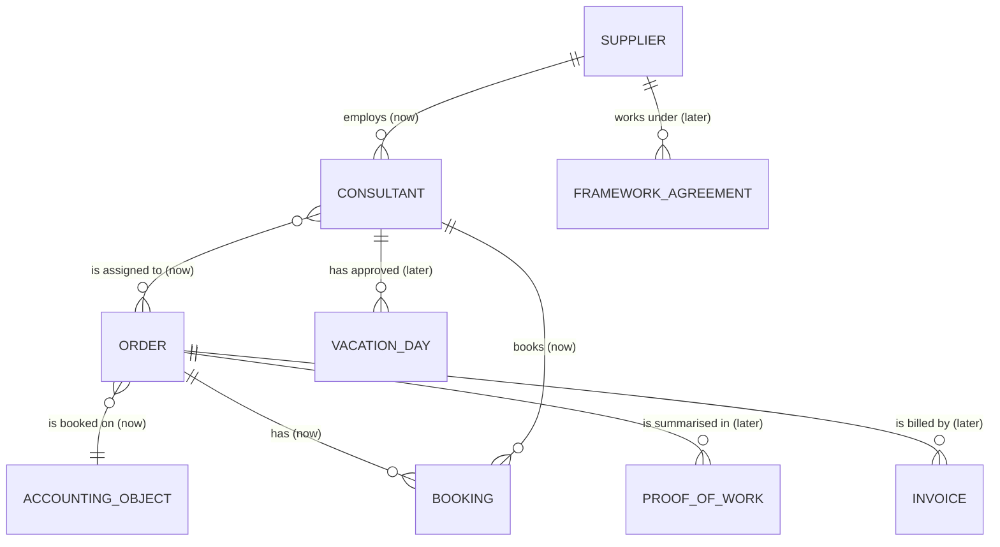

# Domain model

> Filled in on Friday, 30 Oct 2026 (task #18). See [guide 2.3](guide.md#23-model-the-domain).

## Glossary

| Term | Meaning |
|---|---|
| Purchase order (Auftrag) | The client's commission to a supplier for a piece of work: an order number, a budget in person-days and a period. |
| Person-day (PT) | Unit of budget and effort: 8 booked hours equal 1 PT. |
| Accounting object | Client-side cost object (cost centre or project element) that hours are booked against. |
| Consultant | An external person employed by a supplier who books working time on orders. |
| Supplier | The company that delivers consultants and records their working time (e.g. Consultis GmbH). |
| Booking | One entry of working time: date, duration, description, consultant, order and accounting object. Created by a consultant, checked server-side against the business rules before it is stored, and immutable once its proof of work is approved. |
| Free budget | Ordered person-days minus the sum of stored bookings of the order. A booking that would exceed it is rejected. |
| Business rules | Server-side checks before storing a booking: free budget, no overlapping bookings of one person, max 10 h per day and 11 h rest (ArbZG), no bookings on approved vacation or public holidays, booking date inside the order period. |
| Forecast | The projected week in which an order's budget is exhausted, computed from the current booking pace including vacations, public holidays and shutdowns. |
| Proof of work (Leistungsnachweis) | Monthly list of hours per order and supplier, approved by the project lead. Immutable after approval; only approved hours go to finance. |

## Entity relationship diagram

Entities we **build now** are marked `(now)`, entities of the **next expansion stage** `(later)`.

## Notes

- **Remaining budget** = ordered person-days − Σ stored bookings of the order (8 h = 1 PT, so a 7.0 h booking adds 0.875 PT). Rejected bookings are never stored and leave no trace in the data.
- **Bookings reference two anchors**: the order (carries the budget) and the accounting object (carries the client's internal cost view). Both are required at booking time.
- **Assignment**: consultants are assigned to orders (n:m); the server rejects bookings for orders the consultant is not assigned to (story #15).
- **Immutability**: approving a proof of work makes all contained bookings immutable (story #11); the server rejects changes to approved bookings.
- **Vacation days and public holidays** are part of the next expansion stage; the rule engine will use them to reject implausible bookings (story #8).
- **Forecast**: projected exhaustion week = free budget ÷ current booking pace, adjusted for vacations, public holidays and shutdowns; drives the early warning for follow-up orders (stories #10, #14).
